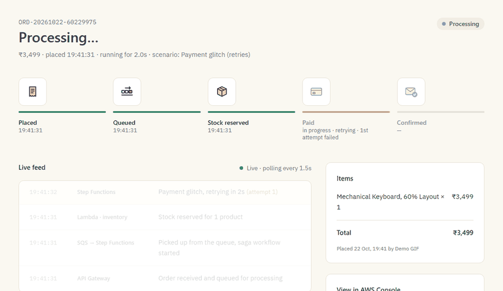
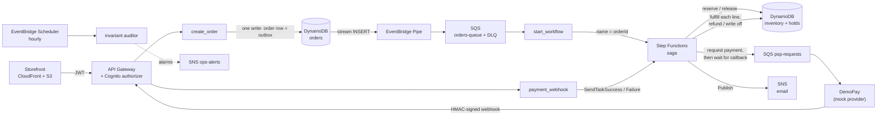
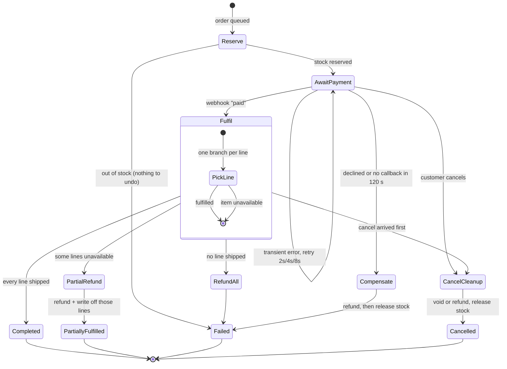
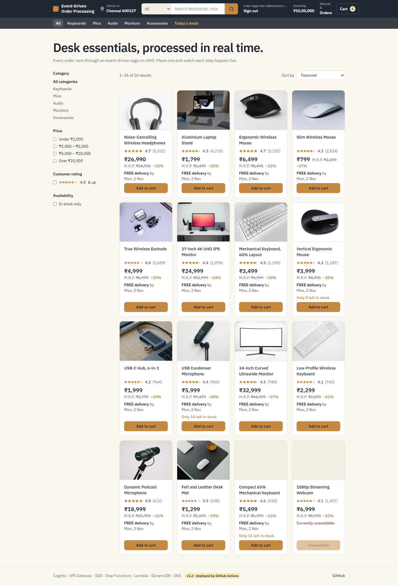
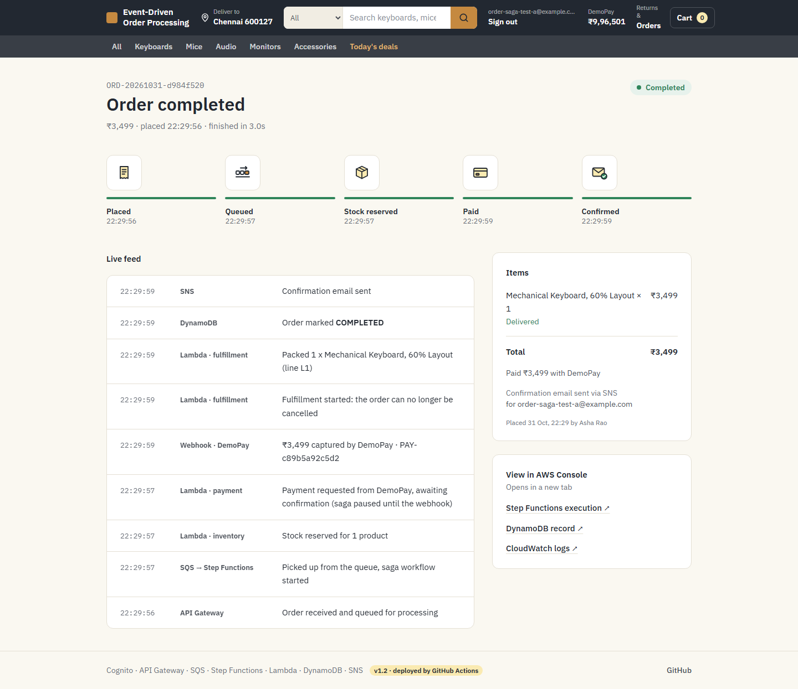
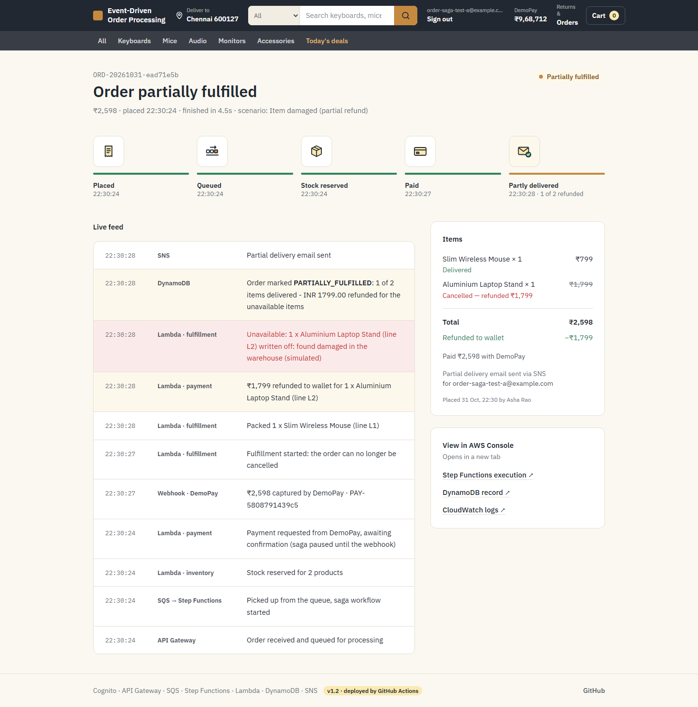
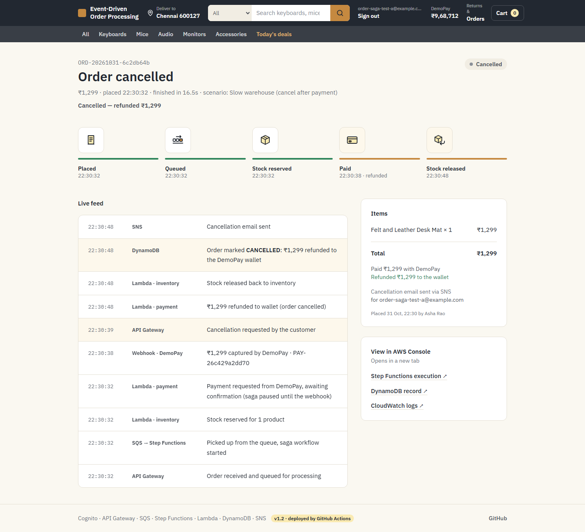
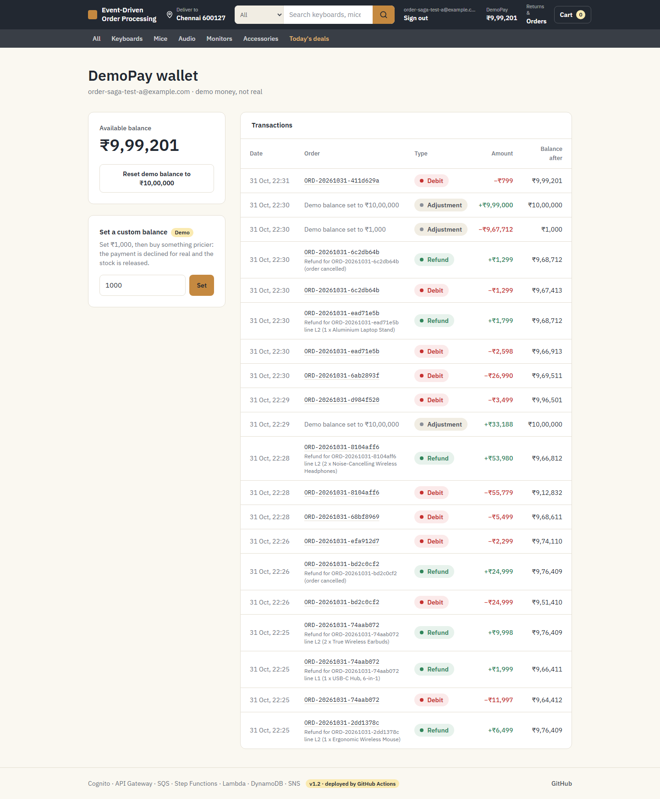

# Event-Driven E-Commerce Order Processing on AWS

[](https://github.com/NITHIN777-DOTCOM/Event-driven-order-processing/actions/workflows/ci.yml) [](https://github.com/NITHIN777-DOTCOM/Event-driven-order-processing/actions/workflows/deploy.yml)  

A live online shop whose orders are processed by a **serverless saga on AWS**. Each order reserves stock, waits for
an asynchronous payment callback, ships item by item, and **undoes its own steps** (refund, release stock) when
something fails: a declined card, a damaged item, a customer who cancels mid-way, or a Lambda that crashes. It was
chaos-tested and load-tested (**25.6 orders/s, ₹0 lost**), and an hourly auditor re-checks that every rupee and
every unit of stock adds up. Built with Step Functions, SQS, DynamoDB, Cognito and Terraform, deployed by GitHub
Actions through OIDC.

**Live storefront:** https://dg38gx94mao9n.cloudfront.net (sign up with any email you can read; payments use
DemoPay, a demo wallet, not real money. At checkout, *Test scenario* lets you trigger each failure path.)



---

## Architecture



| AWS service | What it does here |
|---|---|
| CloudFront + S3 | Serves the React storefront (private bucket behind OAC). |
| Cognito | Sign-up / sign-in; issues the access token the API checks. |
| API Gateway (HTTP API) | Public API; rejects bad tokens before any code runs; 50 req/s stage limit. |
| Lambda (21 functions) | Small single-purpose steps: create order, reserve, request payment, fulfil a line, refund... |
| DynamoDB (on-demand) | Orders, inventory, holds, payments, DemoPay wallets + ledger. Every state change is a conditional write. |
| DynamoDB Streams + EventBridge Pipes | Transactional outbox: a new order row becomes an SQS message, with no second write. |
| SQS + DLQs | Buffers orders and payment requests; poison messages go to a dead-letter queue. |
| Step Functions (Standard) | The saga: retries, waits for the payment callback, compensation, per-item fulfilment. |
| SNS | Customer emails and ops alarms. |
| EventBridge Scheduler | Releases expired checkout holds; runs the hourly invariant audit. |
| CloudWatch + X-Ray | Dashboard, 16 alarms, JSON logs with orderId, traces. |
| IAM + GitHub OIDC | One least-privilege role per Lambda; CI/CD with no stored AWS keys. |

---

## Order flow (the saga)



Every ending sends an email. Compensation runs in reverse order (refund first, then release stock), and every step
is idempotent, so a retry or a redrive is always safe. Full definition:
[`statemachine/order_saga.asl.json`](statemachine/order_saga.asl.json).

---

## Key features

- **Saga + compensation:** a failure after payment refunds the money and releases the stock, in reverse order.
- **Transactional outbox:** the order row *is* the message (DynamoDB Stream -> Pipe -> SQS), so a crash can't lose an order.
- **Async payment with callback:** the saga pauses (`waitForTaskToken`) until DemoPay's HMAC-signed webhook; a late payment is refunded.
- **Checkout holds:** opening checkout holds the cart for 10 minutes; a one-time schedule gives the stock back.
- **Per-item fulfilment + partial refunds:** one damaged item is refunded on its own; the rest still ships.
- **Cancellation race:** cancel, payment and fulfilment race on one DynamoDB item; one conditional write picks exactly one winner.
- **Idempotency:** `Idempotency-Key` on orders, execution name = orderId, refunds keyed per line: never charged or refunded twice.
- **Invariant auditor:** an hourly job re-derives the books (I1-I9: money and stock) and alarms on any mismatch, or when it stops running.

---

## Proven by tests

| Test | Result | Evidence |
|---|---|---|
| Unit tests (pytest + moto) | **417 passed, 94% coverage** (CI gate 85%) | [final report](docs/evidence/upgrade-final-report.md) |
| Live end-to-end suite | **35/35 scenarios passed** (every saga path, money invariants I1-I9 per order) | [e2e-failure-tests.md](docs/evidence/e2e-failure-tests.md) |
| UI suite (Playwright, live storefront) | **11/11 scenarios**, ledger checked after each, 0 console errors | [ui/README.md](docs/evidence/ui/README.md) |
| Cancel race x20 (cancel API vs DemoPay charge, same moment) | **exactly one winner in 20/20: 11 cancel won (nothing charged), 8 cancel won (late charge refunded), 1 payment won (cancel 409); never both** | [e2e-failure-tests.md](docs/evidence/e2e-failure-tests.md) |
| Oversell race (200 requests in 63 ms for 20 units) | **exactly 20 claimed, 180 out of stock, 0 errors**; 100 two-item carts on 10 + 10 units: exactly 10 | [upgrade-3.1-oversell.md](docs/evidence/upgrade-3.1-oversell.md) |
| ... and the bug it found | before the fix: **112 false "sold out"** answers (a DynamoDB conflict read as out of stock) -> 0 | [upgrade-3.1-report.md](docs/evidence/upgrade-3.1-report.md) |
| Chaos E1 (30% errors on 9 Lambdas, 30 orders) | before -> after the fix: orders on their normal path **10 -> 19**, ₹0 lost both times | [e1-before](docs/evidence/upgrade-3.2/e1-before.md), [e1](docs/evidence/upgrade-3.2/e1.md) |
| Chaos E3 (crash right after each write, 12 orders) | invariant violations **2 -> 0**, ₹0 lost | [e3-before](docs/evidence/upgrade-3.2/e3-before.md), [e3](docs/evidence/upgrade-3.2/e3.md) |
| Chaos E2 / E4 / E5 (slow payments, duplicates, refund outage) | 0 problems / PASS / 3 parked, redriven, ₹0 lost | [e2](docs/evidence/upgrade-3.2/e2.md), [e4](docs/evidence/upgrade-3.2/e4.md), [e5-redrive](docs/evidence/upgrade-3.2/e5-redrive.md) |
| Load test, before the fix | API took 43.6 orders/s, but only **13%** of normal orders completed (payment workers capped at 2) | [upgrade-3.3-load.md](docs/evidence/upgrade-3.3-load.md) |
| Load test, after the fix | **25.6 orders/s**, API p95 **82 ms**, completion p95 **6.4 s**, **98.5%** completed, 0 API 5xx | [upgrade-3.3-load.md](docs/evidence/upgrade-3.3-load.md) |
| Money lost, across all of the above | **₹0** (12,704 load-test orders; 16,146 late charges refunded in the failed run) | [upgrade-3.3-load.md](docs/evidence/upgrade-3.3-load.md) |
| Invariant audit after everything | **39,322 orders, 0 violations, 0 stuck**, full scan in 37.4 s | [final report](docs/evidence/upgrade-final-report.md) |

---

## Design decisions & trade-offs

- **Standard vs Express Step Functions:** Standard. The saga waits for a callback (Express can't), can run for
  minutes (Express max 5), must run each money step exactly once (Express is at-least-once) and can be redriven.
  Cost: more per state transition.
- **Conditional writes, not locks:** every transition is one DynamoDB write with a condition (`stock >= qty`,
  `status = X`). No lock to leak or time out; the loser of a race gets a clean "no" and handles it.
- **Expand -> migrate -> contract:** a change ships behind the old path first, is switched on in a later deploy, and
  the old path is removed later still. Learned the hard way in step 2.1: one apply deleted the old payment function
  and then failed before switching the saga, so for ~4 minutes the saga called a missing function (32 test orders
  failed safely, ₹0).
- **Own fault injector instead of AWS FIS:** FIS isn't available on the AWS Free plan (`SubscriptionRequiredException`),
  so a small injector mirrors FIS's Lambda actions (error / delay, percent, duration, stop alarm). Narrower blast
  radius (only the test run's orders), but it can't fake a runtime crash.
- **SQS between the API and the saga:** the API answers in ~50 ms and spikes queue up; the client polls for status.

---

## Known limitations

- **DemoPay is a simulation:** a mock payment provider with a demo wallet, not a real card network.
- **Provider crash = lost sale, not lost money:** if DemoPay crashes, SQS redelivers after its visibility timeout,
  later than the saga's 120 s payment wait; the order times out and any charge is refunded (192 of 12,704 in the load test).
- **~25 orders/s designed limit:** each order uses two requests (order + payment webhook) of the 50 req/s API stage.
- **Full-scan auditor:** it re-reads every table each hour. It outgrew its 180 s timeout at ~39k orders; now 900 s
  plus a heartbeat alarm. At scale it should check only changed orders (DynamoDB Streams). Each hourly scan also
  costs read units (about $6/month at 39k orders).
- Emails go to the operator's inbox (SNS), not to each customer; Cognito's default sender allows only a few emails a day.

---

## Screenshots

<table>
  <tr>
    <td width="50%"><br><sub><b>Storefront</b>: 16 products, live stock</sub></td>
    <td width="50%"><br><sub><b>Tracker</b>: each step an AWS service performed</sub></td>
  </tr>
  <tr>
    <td><br><sub><b>Partial order</b>: one damaged item refunded, the rest shipped</sub></td>
    <td><br><sub><b>Cancel</b>: cancelled mid-saga, money and stock back</sub></td>
  </tr>
  <tr>
    <td colspan="2" align="center"><br><sub><b>Wallet</b>: DemoPay ledger of debits and refunds</sub></td>
  </tr>
</table>

---

## Run, deploy, test

**Needs:** an AWS account + CLI profile, Terraform >= 1.10, Python 3.11+, Node.js 20+. Region `ap-south-1`.

```powershell
# 1. Bootstrap (local state): Terraform state bucket, $5 budget alert, GitHub OIDC roles
cd infra/bootstrap; copy terraform.tfvars.example terraform.tfvars   # set alert_email
terraform init; terraform apply

# 2. App stack (~204 resources): set `bucket` in infra/main/backend.tf to the state bucket first
cd ../main; copy terraform.tfvars.example terraform.tfvars          # set alert_email
terraform init; terraform apply                                     # then confirm the 2 SNS emails

# 3. Data, users, storefront
cd ../..; python -m venv .venv; .venv\Scripts\python -m pip install -r requirements-dev.txt
.venv\Scripts\python scripts\seed_inventory.py
.venv\Scripts\python scripts\create_webhook_secret.py
.venv\Scripts\python scripts\create_test_users.py
.venv\Scripts\python scripts\deploy_frontend.py                     # prints the storefront URL
```

| Test | Command |
|---|---|
| Unit (no AWS needed) | `.venv\Scripts\python -m pytest --cov=src` |
| Live end-to-end (~15 min) | `.venv\Scripts\python scripts\e2e_test.py` |
| UI (Playwright) | `.venv\Scripts\python scripts\capture_ui.py` |
| Oversell race | `.venv\Scripts\python scripts\oversell_race.py` |
| Invariant audit | `.venv\Scripts\python scripts\audit_invariants.py --invoke` |
| Load test | see [`loadtest/`](loadtest/) and [the evidence](docs/evidence/upgrade-3.3-load.md) |

**Deploy:** push to `main`. GitHub Actions runs CI (tests, coverage gate, `terraform validate`, frontend build), then
Deploy (assume the AWS role via OIDC, `terraform apply`, publish the storefront, smoke-test one real order).
Pull requests get a `terraform plan` comment from a read-only role.

**Cost:** everything is pay-per-use (no VPC, NAT, servers). Measured on quiet days before the load test: about
**$0.12/day (~$3.5/month)**. With today's ~39k test orders, the hourly full-scan audit adds an estimated
~$6/month in DynamoDB reads. A $5/month budget alert is the backstop.

**Teardown (in order):** empty the storefront and chaos buckets, set the Cognito user pool's deletion protection to
INACTIVE, `terraform destroy` in `infra/main`, delete the script-made SSM parameters under `/order-saga/`, then
remove `prevent_destroy`, empty the versioned state bucket and `terraform destroy` in `infra/bootstrap`.

More: [redrive runbook](docs/runbooks/redrive-stuck-order.md) · [all evidence](docs/evidence/)

---

## Credits

<details>
<summary>Product photos: Unsplash (Unsplash License)</summary>

All product photos are from [Unsplash](https://unsplash.com) under the [Unsplash License](https://unsplash.com/license). They were cropped to 4:3 and converted to WebP.

| Product | Photographer | Source |
|---|---|---|
| Mechanical Keyboard, 60% Layout | Hannes Köttner | https://unsplash.com/photos/QpTZcTlk08g |
| Compact 65% Mechanical Keyboard | Hannes Köttner | https://unsplash.com/photos/tROXvYvFtB4 |
| Low-Profile Wireless Keyboard | Olena Bohovyk | https://unsplash.com/photos/cHlK4sZXOQo |
| Slim Wireless Mouse | Harpal Singh | https://unsplash.com/photos/KuvEVL7lXYQ |
| Ergonomic Wireless Mouse | Mojtaba Mosayebzadeh | https://unsplash.com/photos/jKwaXJZe1P0 |
| Vertical Ergonomic Mouse | Boitumelo | https://unsplash.com/photos/px2CP31ygUs |
| Noise-Cancelling Wireless Headphones | Kiran CK | https://unsplash.com/photos/LSNJ-pltdu8 |
| True Wireless Earbuds | Daniel Romero | https://unsplash.com/photos/6V5vTuoeCZg |
| USB Condenser Microphone | Axel Mencia | https://unsplash.com/photos/5SoYbzKhqfA |
| Dynamic Podcast Microphone | Jon Tyson | https://unsplash.com/photos/H1ZwfJSsMVk |
| 27-inch 4K UHD IPS Monitor | Rohit | https://unsplash.com/photos/KZnfwqi-B0U |
| 34-inch Curved Ultrawide Monitor | Mediamodifier | https://unsplash.com/photos/9ixBVUCo6NU |
| USB-C Hub, 6-in-1 | Lasse Jensen | https://unsplash.com/photos/a5-AlNgVNZw |
| Aluminium Laptop Stand | Rolf van Root | https://unsplash.com/photos/ISmVDb_20_g |
| Felt and Leather Desk Mat | Muhammet Sain | https://unsplash.com/photos/8e9KCdOj29o |
| 1080p Streaming Webcam | Bedirhan Gul | https://unsplash.com/photos/Gq8qdtRwwJs |

</details>

## License

[MIT](LICENSE) © 2026 Nithin
