# Event-Driven E-Commerce Order Processing on AWS

**A serverless saga that reserves stock, takes payment and notifies customers, and stays correct when things fail.**

[](https://github.com/NITHIN777-DOTCOM/Event-driven-order-processing/actions/workflows/ci.yml) [](https://github.com/NITHIN777-DOTCOM/Event-driven-order-processing/actions/workflows/deploy.yml)   

**Live demo:** https://dg38gx94mao9n.cloudfront.net. Browse freely; **Sign in** (top right) to check out. Use
*Create an account* on the sign-in page: any email you can read works, and Cognito emails you a 6-digit code.
At checkout, open **Test scenario** and try *Payment glitch*, *Payment declined*, *Late payment (auto-refund)* or
*Poison message* to watch each failure path live. Payments use **DemoPay**, a demo wallet (₹10,00,000 per account). It isn't real money.

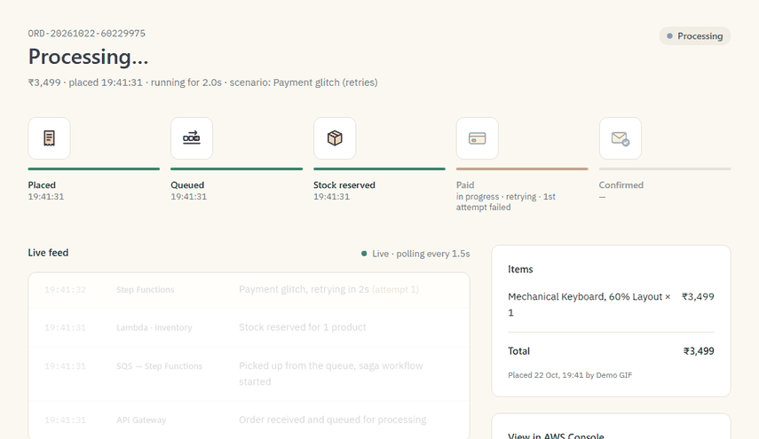

<sub>A real order on the live system. The payment fails twice, Step Functions retries it after 2 s and then 4 s, the wallet is debited once, and the order completes. Every row of the live feed is a step an AWS service performed.</sub>

---

## Highlights

- **Saga with real compensation.** If payment or completion fails, the workflow undoes its own steps in reverse order: it **refunds** the wallet, **releases** the reserved stock, marks the order FAILED with a readable reason, and sends a notification via SNS.
- **Idempotent at three layers.** An `Idempotency-Key` on `POST /orders` stops duplicate orders. The execution name equals the `orderId`, so a duplicate SQS delivery can't start a second saga. Payment and refund are conditional on `paymentId` / `refunded`, so a customer is **never charged or refunded twice**.
- **Asynchronous payments, like a real gateway.** The saga *requests* a payment and **pauses** (`waitForTaskToken`,
  120 s timeout) until the mock provider **DemoPay** confirms through an **HMAC-signed webhook** (raw-body signature,
  ±5 min replay window, constant-time compare). The task token never leaves our system. A payment that arrives after
  the timeout is **refunded automatically**, and four money invariants (one net debit per completed order, zero net
  charge per failed one, no double charge or refund, every intent final) are checked for every e2e scenario.
- **Atomic money movement.** A payment is one DynamoDB `TransactWriteItems` across three tables (wallet balance, ledger entry, order), conditional on enough balance and no prior payment. A low balance is a **real** decline, not a simulated one.
- **Checkout holds with timed release.** Opening checkout holds the cart for **10 minutes** (one DynamoDB transaction:
  stock → held, one ACTIVE hold per user, 409 naming the product that's short). A one-time **EventBridge Scheduler**
  schedule per hold releases it on its own; paying consumes it (held → reserved, stock taken once). Consume, expire
  and release race safely: every transition is one transaction led by a status condition, so exactly one wins.
  Expiry is also enforced logically, because the schedule fires within about a minute, not to the second (measured).
  Stock conservation (I5) is checked for every product.
- **Retries where they help, not where they hurt.** Transient payment errors are retried with exponential backoff (2 s → 4 s → 8 s). A permanent decline goes straight to compensation.
- **Transactional outbox, no dual write.** `create_order` makes exactly one write: the DynamoDB transaction. The new order row *is* the outbox record. A **DynamoDB stream → EventBridge Pipe** (INSERT-only filter) delivers it to SQS, so a crash right after the write can't lose the order.
- **Sign-in and row-level isolation.** Cognito managed login (authorization code + PKCE). API Gateway's **JWT authorizer**
  rejects missing or forged tokens before any Lambda runs; the API takes **access tokens only** (a pre-token-generation
  trigger adds the verified email to them; an ID token gets 401), and the handlers take identity **only from the
  verified claims** (`sub`). Orders and wallets are keyed by the user; someone else's order is a **404**, not a 403; idempotency keys
  are scoped per user.
- **Poison messages are isolated.** After 3 failed receives, SQS moves the message to a dead-letter queue, and a CloudWatch alarm emails the operator.
- **100% infrastructure as code.** 156 resources in the app stack plus 13 in the bootstrap stack, all Terraform, with no console clicks. Every resource is named `order-saga-*` and tagged.
- **CI/CD with no stored keys.** GitHub Actions assumes AWS roles through **OIDC**, scoped to this repo's `main` branch (deploy) or its pull requests (read-only plan). Every merge is applied, published and smoke-tested.
- **Close to $0 when idle.** Everything is pay-per-use: Lambda, Step Functions, on-demand DynamoDB, SQS, SNS, CloudFront and S3. There's no VPC, NAT gateway or server. The one fixed cost is the outbox pipe polling the stream, estimated at about $1.6/month (an estimate from AWS's documented polling rate, not measured; see [the evidence](docs/evidence/upgrade-1.1-outbox.md)). A $5/month budget alert is the backstop.

---

## Architecture

```mermaid
flowchart LR
  user["Browser"] -->|HTTPS| cf["CloudFront"] --> s3[("S3 storefront<br/>private, OAC")]
  user -->|"sign in: code + PKCE"| cog["Cognito<br/>managed login<br/>order-saga-users"]
  cog -->|"access token (JWT)"| user
  user -->|"JSON + Authorization: JWT"| api["API Gateway<br/>HTTP API<br/>JWT authorizer"]
  cog -.->|"signing keys (JWKS)"| api
  api --> co["create_order"]
  api --> reads["get_order · list_orders<br/>list_products · wallet_api"]
  api --> holds["holds_api<br/>POST/GET/DELETE /holds"]
  holds -->|"stock → held<br/>one transaction"| ddb
  holds -->|"one at() schedule per hold"| sched["EventBridge Scheduler<br/>group order-saga-holds"]
  sched -->|"at expiresAt"| hexp["hold_expiry"] -->|"held → stock"| ddb
  co -->|"order + idempotency key<br/>in one transaction"| ddb[("DynamoDB<br/>orders · inventory · idempotency<br/>wallets · wallet-txns · holds")]
  reads --> ddb
  ddb -->|"stream: new order rows"| pipe["EventBridge Pipe<br/>orders-outbox<br/>INSERT only"]
  pipe -->|"{orderId}"| q["SQS<br/>orders-queue"]
  pipe -.->|"undeliverable"| odlq["SQS outbox DLQ"]
  q -->|"batches of 10"| sw["start_workflow"]
  q -.->|"after 3 failed receives"| dlq["SQS DLQ"]
  sw -->|"StartExecution<br/>name = orderId"| sfn["Step Functions<br/>order-saga-workflow"]
  sfn --> lam["reserve · request_payment<br/>refund · release Lambdas"]
  lam --> ddb
  lam -->|"payment request<br/>(no task token)"| pspq["SQS<br/>psp-requests"]
  pspq --> psp["DemoPay<br/>payment_provider<br/>(mock PSP)"]
  pspq -.->|"after 5 failed receives"| pspdlq["SQS psp DLQ"]
  psp -->|"POST /webhooks/payment<br/>HMAC-signed, no JWT"| wh["payment_webhook"]
  wh -->|"SendTaskSuccess / Failure"| sfn
  wh --> ddb
  ssm[("SSM SecureString<br/>webhook secret")] -.-> psp
  ssm -.-> wh
  sfn -->|"direct UpdateItem"| ddb
  sfn -->|"direct Publish"| sns["SNS<br/>notifications"] --> mail["Customer email"]
  dlq -.-> cw["CloudWatch alarms"] -.-> ops["SNS ops-alerts"]
  odlq -.-> cw
  pspdlq -.-> cw
```

**Life of an order**

0. The shopper signs in through **Cognito managed login** (authorization code + PKCE). Every API call carries the
   **access token**, into which the `order-saga-pre-token` trigger has copied the verified email. API Gateway's **JWT
   authorizer** checks its signature, issuer, audience (`client_id`) and expiry; the Lambdas accept only
   `token_use = access` and read the user's id (`sub`) and verified email from the claims, never from the request body.
1. **Checkout hold:** entering checkout calls `POST /holds`. The cart's units move from `stock` to `held` in one
   transaction (or 409 names the product that's short), and a one-time EventBridge Scheduler schedule is set for
   `expiresAt` (+10 min). The page counts down from the server's clock; leaving releases the hold, and if nobody
   pays, the schedule invokes `order-saga-hold-expiry`, which gives the units back.
2. The storefront calls `POST /orders` (with the `holdId`) and an `Idempotency-Key` (scoped to the user). `create_order` validates the order, prices it from inventory on the server, and writes the order plus the idempotency record in **one transaction**. That's its only write. It replies `202 Accepted` right away, without waiting for the saga.
3. **Transactional outbox:** the new order row appears on the table's **DynamoDB stream**. The **EventBridge Pipe** `order-saga-orders-outbox` forwards only INSERTs with status PENDING, as `{"orderId": ...}`, onto **SQS**, which absorbs spikes and decouples the API from the workflow. Delivery is at least once; duplicates are harmless (next step).
4. `start_workflow` consumes batches of 10 messages. It marks the order PROCESSING and starts a **Step Functions** execution named after the order (`ReportBatchItemFailures`: only failed messages are retried).
5. **ReserveInventory** consumes the checkout hold (hold → CONSUMED, held → reserved, order → RESERVED, one
   transaction). Without a usable hold (none, expired, or lost a race with the expiry) it decrements stock for every
   item in one DynamoDB transaction, so stock is never partly reserved.
6. **RequestPayment** (`waitForTaskToken`) creates payment intent `PI-<orderId>`, stores the task token on it, marks
   the order PAYMENT_PENDING ("Awaiting payment confirmation") and queues the request to **DemoPay**. The saga pauses,
   at no cost. DemoPay debits the wallet once per intent (one transaction: balance, ledger, provider record) and
   POSTs a signed callback to `POST /webhooks/payment`. `payment_webhook` verifies the HMAC, moves the intent to
   SUCCEEDED and the order to PAYMENT_CAPTURED, and calls `SendTaskSuccess` (or `SendTaskFailure("PaymentDeclined")`).
   No callback within 120 s → `MarkPaymentTimedOut` → compensation → FAILED "payment timeout".
7. **FulfillItems** (inline Map, up to 5 lines at once) picks each order line on its own with `order-saga-fulfill-item`
   (reserved → sold). A line found damaged after payment is caught **inside its own iteration**, so the rest still
   ships: only that line is refunded (DemoPay line refund, at the price stored on the order, capped at the charge)
   and written off (reserved → writtenOff + an audit record), and the order ends **PARTIALLY_FULFILLED**. If no line
   can be fulfilled, every line is refunded and written off and the order FAILS ("all items unavailable").
8. **MarkOrderCompleted** and **NotifyCustomer** call DynamoDB and SNS **directly from the state machine**, with no Lambda in between.
9. Every step appends `{status, timestamp, detail}` to the order's `statusHistory`. The tracker polls `GET /orders/{id}` every 1.5 s and turns that history into the live feed.

---

## The saga

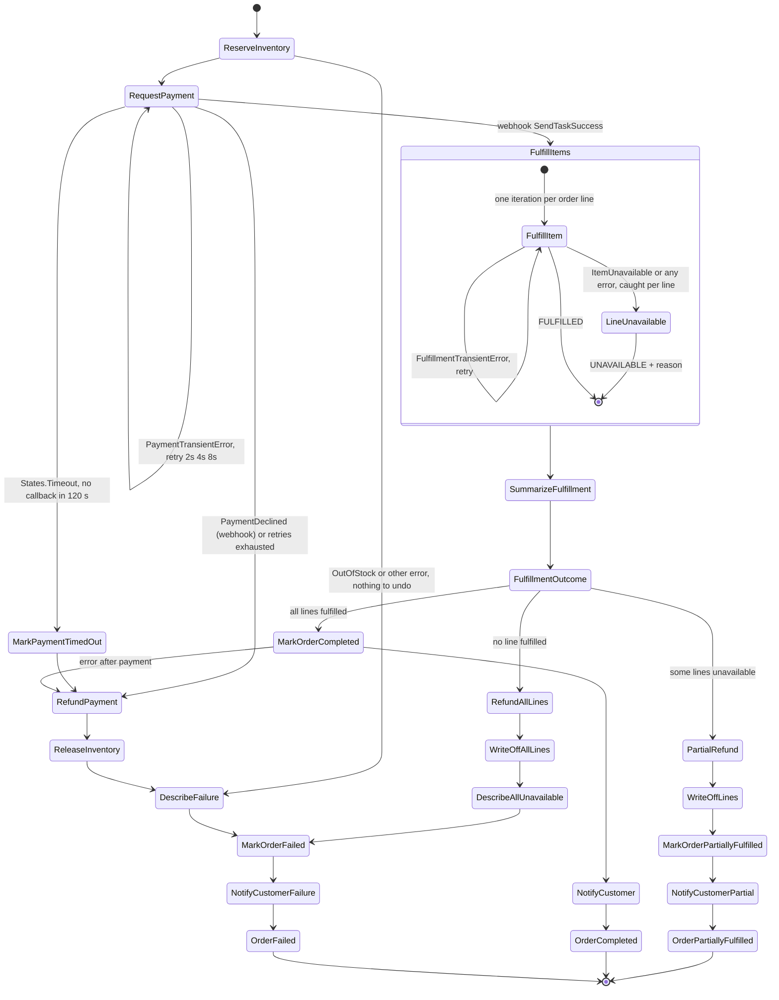

Reservation stays **all-or-nothing** (before payment the customer gets the whole basket or nothing); fulfillment is
**per line** (after payment, one damaged item shouldn't cancel the rest). Every line moves exactly once, to FULFILLED
or WRITTEN_OFF; the refund steps take only line ids and read the amounts from the order. PartialRefund and
WriteOffLines retry and then fail the execution on purpose (alarm `order-saga-refund-or-write-off-errors`, then a
redrive: both are idempotent per line).

Compensation runs in **reverse order**: refund first, then release stock. Both steps are idempotent (`RefundPayment` goes through DemoPay's idempotent refund and is a no-op if nothing was charged), so retries are always safe. `DescribeFailure` is a JSONata Pass state that turns a Lambda error into a readable reason such as *"PaymentDeclined: Insufficient wallet balance: ₹1,000 available, ₹5,999 needed"*. Definition: [`statemachine/order_saga.asl.json`](statemachine/order_saga.asl.json).

---

## Failure handling

| Failure | What happens | Mechanism |
|---|---|---|
| Payment glitch | Retried twice, then succeeds; wallet debited **once** | Step Functions `Retry` on `PaymentTransientError`: up to 3 retries, 2 s interval, backoff ×2 |
| Card declined | No money moves; stock released; order FAILED; email sent | DemoPay's declined webhook → `SendTaskFailure("PaymentDeclined")` → RefundPayment (no-op) → ReleaseInventory |
| Insufficient wallet balance | Real decline; nothing debited; stock released | DemoPay checks `balance >= total` in its transaction, then the same decline path |
| Provider never answers | After 120 s the order FAILS with "payment timeout"; nothing charged; stock released | `TimeoutSeconds: 120` on the `waitForTaskToken` task → `States.Timeout` → intent TIMED_OUT (conditional) → compensation |
| Payment arrives after the timeout | Refunded automatically; the order stays FAILED; net charge 0 | The webhook finds the intent TIMED_OUT and calls DemoPay's idempotent refund (intent → REFUNDED) |
| Duplicate or forged webhook | A duplicate is a 200 no-op; a bad, stale or missing signature is a 401, logged and alarmed | Intent state machine with conditional writes; HMAC-SHA256 over `timestamp.body`, ±5 min; `order-saga-webhook-signature-failures` alarm |
| Payment provider down | Requests retried by SQS (5 receives), then dead-lettered; ops alarm emails | `order-saga-psp-requests` → `order-saga-psp-dlq`; alarm `order-saga-psp-dlq-not-empty` |
| Item damaged after payment | That line refunded and written off; the rest delivered; order PARTIALLY_FULFILLED; email lists the refunded items | Inline Map with a Catch per iteration; DemoPay line refund idempotent per (intent, line) and capped by a running `refundedAmount` (I7); write-off audit record per (order, line) |
| Every item damaged | Every line refunded (intent REFUNDED) and written off; order FAILED "all items unavailable" | `FulfillmentOutcome` Choice → RefundAllLines → WriteOffAllLines |
| Out of stock | Order FAILED; no compensation needed | Reservation is one all-or-nothing transaction; `Catch OutOfStock` skips release |
| Duplicate click or retry | Same order returned (`200`, `duplicate: true`); no second order | `Idempotency-Key` record written in the same transaction as the order (24 h TTL) |
| Duplicate SQS delivery | Ignored; exactly one execution | Conditional PENDING → PROCESSING update; execution name = `orderId` |
| `create_order` crashes right after its write | The order is still delivered and processed | Transactional outbox: the stream INSERT is delivered by the pipe; there's no second write to lose |
| Outbox pipe can't deliver | Retried 5×, then the record's details go to `order-saga-outbox-dlq`; ops alarm emails | Pipe retry policy (5 attempts / 1 h max age); alarms `order-saga-outbox-pipe-failures`, `order-saga-outbox-dlq-not-empty` |
| Poison message | Retried 3× (60 s apart), then dead-lettered; ops alarm emails | SQS redrive `maxReceiveCount 3` → DLQ; CloudWatch alarm `order-saga-dlq-not-empty` |

---

## Design decisions & trade-offs

| Decision | Why | Trade-off |
|---|---|---|
| **SQS in front of the workflow** | The API answers without waiting for the saga; spikes queue up instead of failing; poison messages are isolated in a DLQ | Status is eventually consistent, so clients must poll, and there's a short delay before the saga starts |
| **Transactional outbox via Streams + Pipes** | No dual write: the order and its "message" are the same DynamoDB write; no relay code to own | An estimated ~$1.6/month of idle stream polling (a Lambda relay on the stream would be free at idle but is code to own) |
| **Step Functions instead of Lambdas calling Lambdas** | Retries, catches and compensation are declared in one place and visible as a graph; full execution history | ASL is verbose; there's a per-transition cost |
| **Standard workflow, not Express** | Exactly-once step execution and a 90-day execution history in the console, which matter for payments | Costs more per transition than Express at high volume |
| **Reserve stock before charging** | Never take money for something that can't ship; out-of-stock needs no refund | Stock is held briefly for orders whose payment then fails (released by compensation) |
| **Direct SDK integrations** (DynamoDB, SNS) | Fewer Lambdas and cold starts; less code to maintain | Logic in ASL/JSONata is harder to unit-test than Python |
| **Cognito + API Gateway JWT authorizer** | Token checks are configuration, not code; bad tokens are rejected before a Lambda runs; free up to 10,000 monthly users | Ownership ("is this order yours?") still has to be checked in each handler; the email reaches the access token only through a pre-token-generation Lambda that runs on every sign-in and refresh |
| **HTTP API instead of REST API** | Cheaper, lower latency, built-in CORS | No X-Ray tracing, WAF or usage plans; traces start at the first Lambda |
| **On-demand DynamoDB** | $0 when idle, no capacity planning | More expensive per request than provisioned capacity under steady heavy load |

---

## Tech stack

| Layer | Technology |
|---|---|
| AWS | Cognito (user pool, managed login), API Gateway (HTTP API + JWT authorizer), Lambda (Python 3.12, arm64), DynamoDB Streams, EventBridge Pipes, SQS + DLQ, Step Functions (Standard), DynamoDB, SNS, S3, CloudFront (OAC), CloudWatch, X-Ray, IAM, Budgets |
| Infrastructure as code | Terraform ≥ 1.10, S3 remote state with native locking; separate bootstrap stack |
| Backend | Python, boto3, structured JSON logging, aws-xray-sdk (via the AWS Powertools layer) |
| Frontend | React 18, TypeScript, Vite, Tailwind CSS, React Router, oidc-client-ts + react-oidc-context |
| Testing | pytest + moto (unit), live end-to-end scenario suite, Playwright (UI) |
| CI/CD | GitHub Actions, AWS OIDC (no stored keys), plan-on-PR comments, smoke test after every deploy |

---

## Testing & evidence

- **266 unit tests, 93% coverage**, run with pytest + moto, no AWS needed. CI fails below 85%.
- **Live end-to-end suite** ([`scripts/e2e_test.py`](scripts/e2e_test.py)): **29/29 scenarios passed** against the deployed system, signed in as two Cognito test users, including DemoPay ledger checks and money invariants, the transactional outbox, per-user isolation, the payment webhook, checkout holds and per-item fulfillment with partial refunds (money invariants I1–I7 for every order).

| # | Scenario | Result |
|---|---|---|
| a | Normal order → COMPLETED, stock −1, wallet debited once | PASS |
| b | Payment declined → FAILED, stock restored, RefundPayment no-op | PASS |
| c | Payment glitch → 2 retries → COMPLETED, exactly 1 debit | PASS |
| d | Out of stock → FAILED, nothing reserved, no release step | PASS |
| e | Same Idempotency-Key ×3 → 1 order, 1 stream INSERT, 1 execution, 1 debit | PASS |
| f | Same SQS message delivered 3× → 1 execution | PASS |
| g | Poison message → in the orders DLQ within ~3 min (not the outbox DLQ), order stays PENDING | PASS |
| h | Wallet balance too low → real decline, nothing debited, stock released | PASS |
| i | Crash simulation: order row written straight into DynamoDB, no SQS send → COMPLETED via the outbox | PASS |
| j | MODIFY on an existing order (status back to PENDING) → not re-delivered | PASS |
| k | No token / tampered / forged token → 401 from the JWT authorizer; ID token → 401 (access tokens only); access token carries the trigger's email claims → 200; `GET /products` public | PASS |
| l | User A reading B's order → 404 (worded like a missing order); each order list holds only its owner's orders | PASS |
| m | A's wallet reset with B's ids in the body → only A's wallet changes | PASS |
| n | B reusing A's Idempotency-Key → B's own new order; A's replay still returns A's | PASS |
| o | Payment webhook: unsigned / forged / stale / future signature → 401; valid signature, unknown intent → 404 no-op | PASS |
| p | No payment callback within 120 s → compensated, FAILED, nothing charged | PASS |
| q | Payment confirmed after the timeout → refunded automatically, order stays FAILED | PASS |
| r | Webhook delivered twice → COMPLETED, debited once | PASS |
| s | Forged callback rejected (401); the genuine one completes the order | PASS |
| t | Checkout hold: stock → held + schedule; a 2nd hold releases the 1st; 400 over the cap; 409 naming the short product; DELETE releases | PASS |
| u | 30 s hold released by its EventBridge Scheduler schedule (lag 11.8–45.9 s measured); schedule deletes itself | PASS |
| v | Two users race for the last unit → exactly one 201, one 409 | PASS |
| w | B can't see or release A's hold (404) | PASS |
| x | I5 stock conservation for all 16 products: seeded = stock + held + reserved + sold + writtenOff | PASS |
| za | 3 lines, line 2 damaged after payment → PARTIALLY_FULFILLED; 1 CREDIT for line 2 only; net = lines 1 + 3 (I6) | PASS |
| zb | every line damaged → FAILED "all items unavailable"; every line refunded and written off; net ₹0 | PASS |
| zc | checkout hold + damaged last line → hold consumed once, PARTIALLY_FULFILLED | PASS |
| y | Order with its hold → hold CONSUMED, stock taken once; B can't use A's hold (400) | PASS |
| z | Order after its hold expired → reserved afresh, hold stays EXPIRED | PASS |

- **UI suite** ([`scripts/capture_ui.py`](scripts/capture_ui.py)): every scenario driven through the deployed storefront in Chromium, signing in through Cognito managed login. **8/8**, with ledger checks, the checkout-hold countdown, and a fake-clock run that shows "Your hold expired".
- **Every deploy** runs a smoke test: one real order must reach COMPLETED within 60 s with exactly one wallet debit.
- Evidence: [`docs/evidence/`](docs/evidence/). The e2e results are in [`e2e-failure-tests.md`](docs/evidence/e2e-failure-tests.md), UI screenshots in [`ui/`](docs/evidence/ui/), monitoring in [`phase3-monitoring.md`](docs/evidence/phase3-monitoring.md), CI/CD runs in [`phase5-cicd.md`](docs/evidence/phase5-cicd.md) sign-in/isolation in [`upgrade-1.2-auth.md`](docs/evidence/upgrade-1.2-auth.md) access tokens in [`upgrade-2.0-access-tokens.md`](docs/evidence/upgrade-2.0-access-tokens.md) and checkout holds in [`upgrade-2.2-holds.md`](docs/evidence/upgrade-2.2-holds.md).

### Observability

- **Dashboard** `order-saga-dashboard`: orders started, succeeded and failed with success rate, API traffic, queue and DLQ depth, the Lambdas, DynamoDB, a table of the latest failed orders, and checkout holds (active holds, transitions, expiry lag).
- **11 alarms → SNS `order-saga-ops-alerts`**. System faults (DLQ not empty, consumer errors, API 5xx, stuck executions, queue backlog, outbox and payment DLQs, forged webhooks, hold-expiry errors) are separate from a business alarm: failure rate > 50%, evaluated only when at least 5 orders have started. A declined payment is a normal outcome, not an incident.
- **Saved Logs Insights queries**, such as *Trace one order*, which follows one `orderId` across every Lambda and the Step Functions log.
- **X-Ray**: one trace follows an order from `create_order` through SQS and Step Functions to DynamoDB.

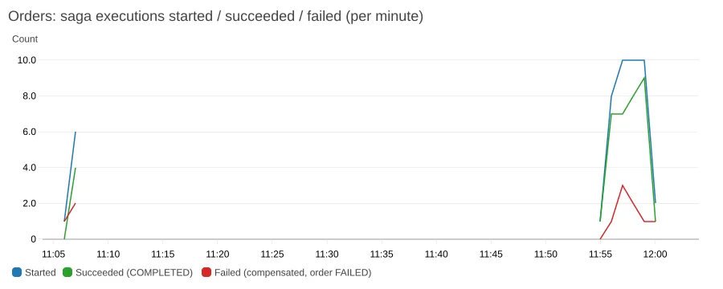

---

## Screenshots

<table>
  <tr>
    <td width="50%">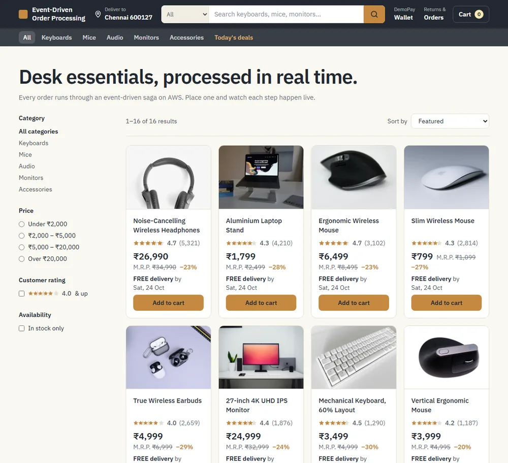<br><sub><b>Shop</b>: 16 products, filters, sort, ratings, live stock</sub></td>
    <td width="50%">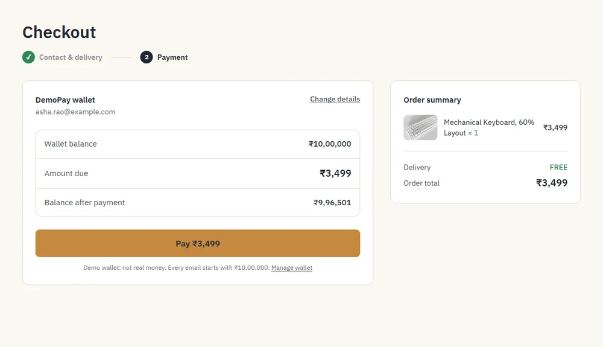<br><sub><b>Checkout</b>: DemoPay wallet, balance after payment</sub></td>
  </tr>
  <tr>
    <td>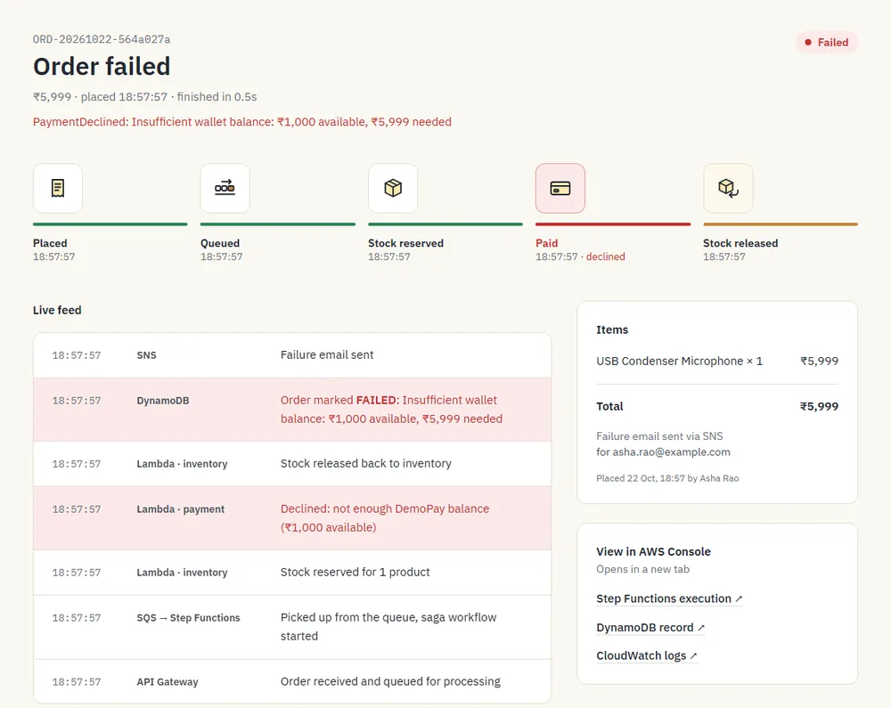<br><sub><b>A real decline</b>: insufficient balance, stock released, failure email</sub></td>
    <td>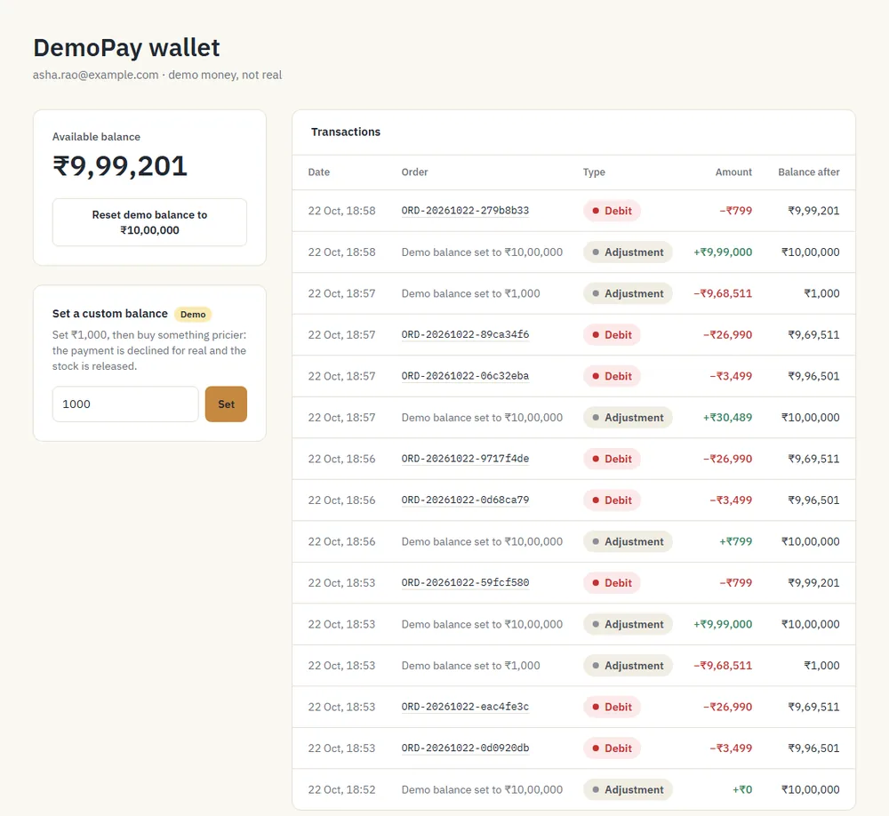<br><sub><b>Wallet</b>: ledger of debits, refunds and demo adjustments</sub></td>
  </tr>
  <tr>
    <td>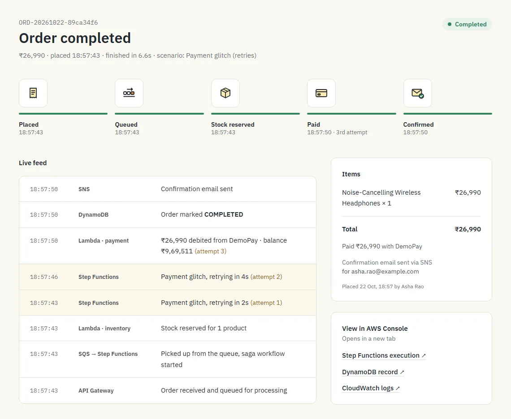<br><sub><b>Tracker</b>: progress steps and what each AWS service did</sub></td>
    <td align="center">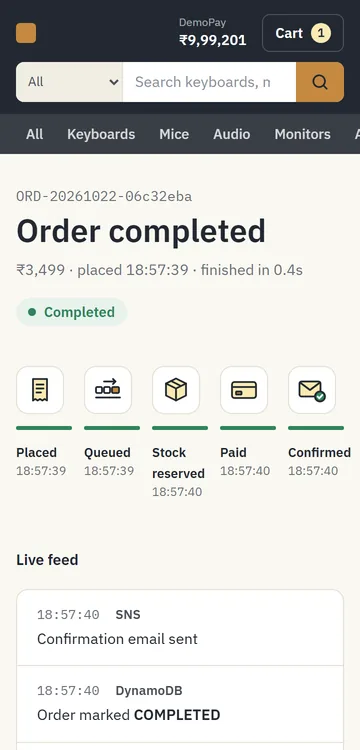<br><sub><b>Mobile</b>: responsive down to 360 px</sub></td>
  </tr>
  <tr>
    <td colspan="2" align="center">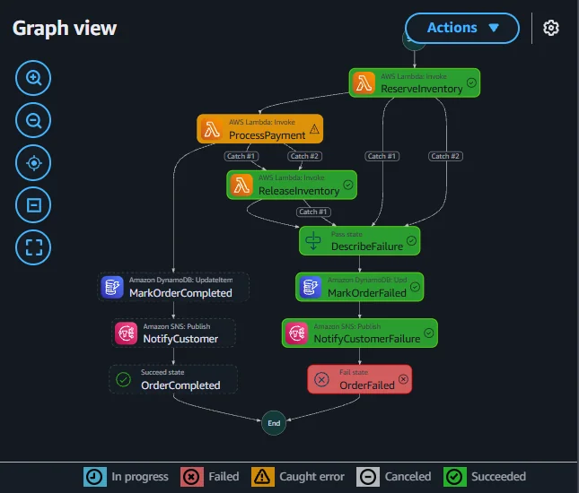<br><sub>Saga compensation in the Step Functions console</sub></td>
  </tr>
</table>

---

## Run it yourself

**Prerequisites:** an AWS account with a CLI profile, Terraform ≥ 1.10, Python 3.11+, Node.js 20+. The default region is `ap-south-1`.

```powershell
# 1. Bootstrap: Terraform state bucket, $5 budget alert, GitHub OIDC roles (local state)
cd infra/bootstrap
copy terraform.tfvars.example terraform.tfvars        # set alert_email
terraform init; terraform apply                       # note the output state_bucket_name

# 2. App stack: set `bucket` in infra/main/backend.tf to that state bucket first
cd ../main
copy terraform.tfvars.example terraform.tfvars        # set alert_email
terraform init; terraform apply
# confirm the 2 "AWS Notification - Subscription Confirmation" emails

# 3. Data, storefront and a full test run
cd ../..
python -m venv .venv; .venv\Scripts\python -m pip install -r requirements-dev.txt
.venv\Scripts\python scripts\seed_inventory.py
.venv\Scripts\python scripts\create_test_users.py    # Cognito test users A + B (passwords -> SSM SecureStrings)
.venv\Scripts\python scripts\deploy_frontend.py       # prints the CloudFront URL
.venv\Scripts\python scripts\e2e_test.py              # ~4 min, 14 scenarios
```

On macOS or Linux, use `cp` and `.venv/bin/python`. To use CI/CD in a fork, set
`github_oidc_subject_prefix` in `infra/bootstrap/variables.tf` to your repository's OIDC subject
(`gh api repos/<owner>/<repo>/actions/oidc/customization/sub`), then set the repo variables
`AWS_DEPLOY_ROLE_ARN`, `AWS_PLAN_ROLE_ARN` and `ALERT_EMAIL`.

**Cost:** about $0 when idle. Demo traffic stays within the AWS free tier: 1 of 3 free dashboards, 8 of 10 free alarm metrics, and pay-per-use for everything else.

**Tear down:** empty the `order-saga-frontend-*` bucket, then run `terraform destroy` in `infra/main`. The state bucket in `infra/bootstrap` has `prevent_destroy`; remove that line before destroying the bootstrap stack.

---

## Repository structure

```
infra/bootstrap/   Terraform: state bucket, budget, GitHub OIDC provider + CI roles (local state)
infra/main/        Terraform: every app resource, one file per concern (api, queue, sfn, lambda, dynamodb, ...)
statemachine/      Step Functions definition (ASL), rendered with templatefile()
src/lambdas/       one folder per Lambda handler (10)
src/common/        shared helpers: logging, orders, wallet, feed, tracing, money
frontend/          React + Vite storefront (served from S3 via CloudFront)
tests/unit/        pytest + moto unit tests
scripts/           seed, deploy, e2e/smoke/UI tests, traffic generator, evidence collection
docs/              progress log, evidence, images, resume bullets
.github/workflows/ ci.yml (tests, validate, PR plan) and deploy.yml (apply, publish, smoke test)
```

---

## Security notes & known limitations

- **Authentication:** Cognito user pool `order-saga-users` (self-sign-up, email verification), managed login with
  authorization code + PKCE; the public `spa` app client has no password API flow at all. Scripts and CI sign in as
  test users through a separate IAM-gated `automation` client; their passwords live only in SSM SecureStrings.
- **Authorization:** every route except `GET /products` needs a valid Cognito **access token** (an ID token is
  rejected with 401). A pre-token-generation trigger (`order-saga-pre-token`, V2_0) adds `email` + `email_verified`
  to access tokens and nothing else. Handlers use only the token's `sub`/verified email; orders and wallets are per
  user, and another user's order returns 404.
- **Token storage:** tokens are in `sessionStorage` (cleared when the tab closes), 60-minute lifetime, refresh tokens
  rotate. An XSS bug could still read them; there is no Content-Security-Policy header yet.
- **Cognito's default email sender** is limited to a few dozen emails per day per account (sign-up codes); a busy
  demo day could hit it. Production would send through SES.
- **Notification emails go to the SNS topic's subscriber** (the operator's inbox), not to the signed-in user's address. A production system would use SES or per-customer SNS endpoints.
- **No sweeper for stuck PENDING orders.** The outbox fixed the dual write. But if delivery failed for longer than the stream's 24 h retention, nothing would re-send the order. The fix is a scheduled sweeper that re-sends `{orderId}` for old PENDING orders (safe, because `start_workflow` is idempotent).
- **Tracing gap:** HTTP APIs don't support X-Ray, and the state machine's own segment doesn't appear in the service map (trace propagation to its Lambdas works).
- **Least privilege:** each Lambda has its own IAM role scoped to the exact tables and queues it uses. The CI deploy role is limited to `order-saga-*` resources and can't modify itself.
- **Edge security:** the API uses stage-level throttling, CORS is restricted to the storefront and localhost, the S3 bucket is private behind OAC, and the bucket policy is TLS-only.

---

## Roadmap

- [ ] Load test with k6 and a scaling graph (not run yet, so there are no throughput claims)
- [x] Cognito sign-in for customers; wallets and orders keyed by user ID
- [ ] Publish order events to EventBridge (analytics, a shipping service)
- [ ] Shipping step in the saga, with a cancellation window
- [ ] Per-customer emails with Amazon SES (SNS topic currently notifies a single subscribed inbox)
- [x] Transactional outbox (DynamoDB Streams → Pipes) for create_order
- [ ] AWS WAF on CloudFront, and a custom domain with ACM

---

## Credits

<details>
<summary>Product photos: Unsplash (Unsplash License)</summary>

All product photos are from [Unsplash](https://unsplash.com) under the [Unsplash License](https://unsplash.com/license). They were cropped to 4:3 and converted to WebP.

| Product | Photographer | Source |
|---|---|---|
| Mechanical Keyboard, 60% Layout | Hannes Köttner | https://unsplash.com/photos/QpTZcTlk08g |
| Compact 65% Mechanical Keyboard | Hannes Köttner | https://unsplash.com/photos/tROXvYvFtB4 |
| Low-Profile Wireless Keyboard | Olena Bohovyk | https://unsplash.com/photos/cHlK4sZXOQo |
| Slim Wireless Mouse | Harpal Singh | https://unsplash.com/photos/KuvEVL7lXYQ |
| Ergonomic Wireless Mouse | Mojtaba Mosayebzadeh | https://unsplash.com/photos/jKwaXJZe1P0 |
| Vertical Ergonomic Mouse | Boitumelo | https://unsplash.com/photos/px2CP31ygUs |
| Noise-Cancelling Wireless Headphones | Kiran CK | https://unsplash.com/photos/LSNJ-pltdu8 |
| True Wireless Earbuds | Daniel Romero | https://unsplash.com/photos/6V5vTuoeCZg |
| USB Condenser Microphone | Axel Mencia | https://unsplash.com/photos/5SoYbzKhqfA |
| Dynamic Podcast Microphone | Jon Tyson | https://unsplash.com/photos/H1ZwfJSsMVk |
| 27-inch 4K UHD IPS Monitor | Rohit | https://unsplash.com/photos/KZnfwqi-B0U |
| 34-inch Curved Ultrawide Monitor | Mediamodifier | https://unsplash.com/photos/9ixBVUCo6NU |
| USB-C Hub, 6-in-1 | Lasse Jensen | https://unsplash.com/photos/a5-AlNgVNZw |
| Aluminium Laptop Stand | Rolf van Root | https://unsplash.com/photos/ISmVDb_20_g |
| Felt and Leather Desk Mat | Muhammet Sain | https://unsplash.com/photos/8e9KCdOj29o |
| 1080p Streaming Webcam | Bedirhan Gul | https://unsplash.com/photos/Gq8qdtRwwJs |

</details>

## License

[MIT](LICENSE) © 2026 Nithin
