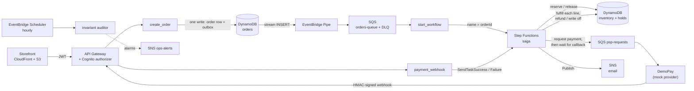

# Interview cheat sheet: Event-driven order saga on AWS

Short version of [interview-prep.md](interview-prep.md). Every number links to its evidence file in the tables.

## 1. 30-second pitch
I built a live online shop whose orders run as a **saga on AWS Step Functions**: reserve stock, wait for an async
payment callback, ship item by item, and **undo its own steps** when anything fails. I then tried to break it:
chaos experiments, a 200-request oversell race and a k6 load test (**25.6 orders/s, ₹0 lost**), with an hourly
auditor that re-checks every rupee and every unit of stock. It's all Terraform, deployed by GitHub Actions via OIDC.

## 2. Architecture in one picture

- **CloudFront + S3:** hosts the React storefront.
- **Cognito:** sign-in; issues the access token.
- **API Gateway:** checks the token before any code runs; 50 req/s limit.
- **Lambda:** 21 small single-purpose steps.
- **DynamoDB:** all state; every change is a conditional write.
- **Streams + Pipes:** turn a new order row into an SQS message (the outbox).
- **SQS + DLQ:** buffer work; park poison messages.
- **Step Functions (Standard):** the saga: retries, waits, compensation.
- **SNS:** customer emails and ops alarms.
- **EventBridge Scheduler:** expires checkout holds; runs the hourly audit.
- **CloudWatch / X-Ray:** dashboard, 16 alarms, logs with orderId, traces.

## 3. The 6 big ideas

### Saga + compensation
- **What:** each order is a Step Functions workflow; each step has an "undo".
- **Why:** no distributed transaction across stock, payment and shipping; each step commits on its own.
- **How:** a failure after payment runs refund, then release stock (reverse order). Each undo is idempotent, so retries
  and redrives are safe. One damaged item = refund that line only (PARTIALLY_FULFILLED).
- **Proof:** chaos E1 (30% of calls fail on 9 Lambdas): orders on their normal path 10 -> 19 of 30 after the fix, ₹0 lost.
- **Q:** *Why not 2PC?* Services don't share a transaction manager, and holding locks during a 120 s payment wait doesn't scale.

### Transactional outbox
- **What:** create_order makes ONE write; the new order row is the message.
- **Why:** "write DB, then send to SQS" loses the order if the Lambda dies between the two.
- **How:** DynamoDB Stream -> EventBridge Pipe (INSERT-only filter) -> SQS. At-least-once; duplicates are harmless.
- **Proof:** e2e scenario i: order row written straight into DynamoDB, no SQS send -> it still COMPLETED.
- **Q:** *Duplicates?* Execution name = orderId, so a second StartExecution is rejected; a conditional PENDING -> PROCESSING update.

### Payment callback + cancel race
- **What:** the saga pauses (`waitForTaskToken`, 120 s) until DemoPay's HMAC-signed webhook says paid or declined.
- **Why:** real gateways are async; you can't hold a Lambda open for a payment.
- **How:** cancel, the webhook's capture and BeginFulfillment write the same order item, each with a condition that
  excludes the others, so exactly one wins. Cancel answers the token with `SendTaskFailure`, never `StopExecution`,
  so the saga cleans up itself.
- **Proof:** cancel race x20 (cancel and charge fired at the same moment): exactly one winner in 20/20: 11 cancel won (nothing charged), 8 cancel won (late charge refunded), 1 payment won (cancel 409); never both.
- **Q:** *Payment arrives after the 120 s timeout?* The webhook sees TIMED_OUT and refunds it automatically.

### No overselling
- **What:** stock can never go below 0, even under a burst.
- **Why:** the classic e-commerce race: two buyers, one unit.
- **How:** one DynamoDB transaction with `stock >= qty` for the whole cart; no locks. Only `ConditionalCheckFailed`
  means sold out; a `TransactionConflict` is retried with jitter.
- **Proof:** 200 requests in 63 ms for 20 units -> exactly 20 claimed, 180 out of stock, 0 errors; 100 carts on
  10 + 10 units -> exactly 10, never half a cart.
- **Q:** *How do you know the test can fail?* A negative control: a broken unconditional reserve sells 50 of 5.

### Idempotency + chaos
- **What:** every retry is safe; then prove it by breaking things on purpose.
- **Why:** SQS, webhooks and users all retry; Lambdas die after writing but before returning.
- **How:** Idempotency-Key per user (same transaction as the order); execution name = orderId; one debit per payment
  intent; refunds keyed per line. Chaos: injected errors and delays, crash-after-write switches, duplicate deliveries.
- **Proof:** E3 (crash right after each write): violations 2 -> 0 after the fix; E4 duplicates: PASS; ₹0 lost in every run.
- **Q:** *Why not AWS FIS?* Not available on the Free plan; I built an injector with FIS's contract (rate, duration, stop alarm).

### Invariant auditor
- **What:** an hourly read-only job that re-derives the books: I1-I9 (money per order, stock per product).
- **Why:** an independent check that doesn't trust the code that wrote the data, like reconciling bank statements.
- **How:** strongly consistent scans of 7 tables; a violation must appear in two audits 10 s apart; it pages, never repairs.
  A heartbeat alarm fires if no audit finishes for 2 hours.
- **Proof:** 39,322 orders audited: 0 violations, 0 stuck, in 37.4 s.
- **Q:** *At 10x data?* Incremental: re-check only orders changed on DynamoDB Streams; full scan weekly as a backstop.

## 4. Numbers to remember

| Number | Value | Source |
|---|---|---|
| Sustained throughput | 25.6 orders/s (designed limit ~25) | [load](evidence/upgrade-3.3-load.md) |
| API latency (server) | p50 51 ms, p95 82 ms, p99 99 ms | [load](evidence/upgrade-3.3-load.md) |
| Order completion | p50 4.7 s, p95 6.4 s | [load](evidence/upgrade-3.3-load.md) |
| Normal orders completed | 13% before -> 98.5% after the fix | [load](evidence/upgrade-3.3-load.md) |
| Money lost | ₹0 (12,704 orders; 16,146 late charges refunded in run 1) | [load](evidence/upgrade-3.3-load.md) |
| Oversell race | 200 req / 63 ms / 20 units -> 20 claimed, 0 errors | [3.1](evidence/upgrade-3.1-oversell.md) |
| False "sold out" before the fix | 112 | [3.1 report](evidence/upgrade-3.1-report.md) |
| Chaos E1 normal path | 10 -> 19 of 30 | [e1-before](evidence/upgrade-3.2/e1-before.md) / [e1](evidence/upgrade-3.2/e1.md) |
| Chaos E3 violations | 2 -> 0 | [e3-before](evidence/upgrade-3.2/e3-before.md) / [e3](evidence/upgrade-3.2/e3.md) |
| Tests | 417 unit, 94% coverage; e2e 35/35; UI 11/11 | [final](evidence/upgrade-final-report.md), [e2e](evidence/e2e-failure-tests.md), [ui](evidence/ui/README.md) |
| Audit | 39,322 orders, 0 violations, 37.4 s | [final](evidence/upgrade-final-report.md) |
| Payment wait / retries | 120 s; transient retry 2 s -> 4 s -> 8 s | [ASL](../statemachine/order_saga.asl.json) |

## 5. Debugging stories

**2.1 outage -> expand / migrate / contract.** One apply switched the state machine to a new function AND deleted
the old one. Terraform ran the delete first, then the switch failed on a tag value only the AWS API checks. For a
few minutes the saga pointed at a missing function: 32 probe orders failed, but compensation kept every one at ₹0.
Fix: never remove in the same apply as the switch; tag values validated at plan time.

**112 false sold-outs.** The first oversell race said "sold out" 112 times while stock was left. DynamoDB cancels a
transaction for a conflict (two writers on one item) the same way as a failed condition, and I read both as out of
stock. Fix: retry `TransactionConflict` with jitter; only `ConditionalCheckFailed` is a real no. Then 0.

**Redriving a Fail state does nothing.** A refund that kept failing was caught and the order went to the `OrderFailed`
Fail state: FAILED with money still owed. Redrive resumes AT the failed state, so it re-ran nothing
(ExecutionRedriven -> ExecutionFailed). Fix: no Catch on refund/release, so the execution fails ON the refund task;
the auditor flags it STUCK and a redrive re-runs the refund.

**Load test 13% -> 98.5%.** Run 1 "passed" at the API (43.6 orders/s) but completion p50 was exactly 120.7 s, the
payment timeout. DemoPay's queue had max 2 workers (~8 payments/s). Fix: 20 workers + in-process retries. Lesson:
in an async system, measure completions, not accepted requests.

**Auditor timeout -> heartbeat.** At ~39k orders the full scan passed its 180 s timeout. A dead auditor publishes
nothing, and its alarms ignore missing data, so it looked clean. Fix: 900 s and 1 vCPU (now 37 s), plus an
`AuditCompleted` heartbeat alarm. "Monitor the monitor."

## 6. Trade-offs & limitations
- **Standard vs Express:** Standard: callback waits, runs > 5 min, exactly-once steps, redrive. Costs more per transition.
- **DemoPay timeout:** a provider crash is redelivered after the queue's visibility timeout, later than the 120 s
  wait: lost sale (refunded), never lost money. 192 of 12,704 in the load test.
- **Full-scan auditor:** cost and time grow with table size (~60k read units per run at 39k orders).
- **Simulated payments:** DemoPay is a mock with a demo wallet; the webhook contract (HMAC, replay window) is real.
- **~25 orders/s cap:** two requests per order through a 50 req/s stage, on purpose (cost guard).

## 7. If I had more time
1. Incremental auditor on DynamoDB Streams (cost follows traffic, not table size).
2. Shorter provider visibility timeout, so a DemoPay crash is retried inside the 120 s payment wait.
3. Per-customer emails through SES, and a sweeper for orders stuck in PENDING beyond the stream's 24 h.
4. WAF + a Content-Security-Policy header on the storefront.

## 8. Mini glossary
- **Saga:** a long business process split into steps, each with an undo, instead of one big transaction.
- **Compensation:** the undo step (refund, release stock) run when a later step fails.
- **Idempotency:** doing it twice has the same effect as once (a retried payment charges once).
- **Outbox:** write the message in the same database write as the data, and let a relay deliver it.
- **DLQ:** dead-letter queue: where a message goes after failing N times, so it stops blocking others.
- **Conditional write:** "update only if this is still true" (`stock >= 1`); the loser of a race gets a clean no.
- **Task token:** an id Step Functions hands out while it waits; whoever holds it resumes the workflow.
- **Redrive:** restart a failed execution from the step that failed, keeping what already succeeded.
- **OIDC:** GitHub proves who it is to AWS with a short-lived token; no stored access keys.
- **Invariant:** a rule that must always be true (net charge = value of delivered items).
- **p95:** 95% of requests were at least this fast.
