# Phase 3 evidence: monitoring, alarms, tracing

Collected: 2026-10-22 12:04:36 UTC · Region: ap-south-1 · Window: last 60 min
Command: `python scripts/collect_evidence.py --order-id ORD-20261022-13c33683`

- Dashboard: https://ap-south-1.console.aws.amazon.com/cloudwatch/home?region=ap-south-1#dashboards/dashboard/order-saga-dashboard
- Alarms: https://ap-south-1.console.aws.amazon.com/cloudwatch/home?region=ap-south-1#alarmsV2:?search=order-saga
- X-Ray service map: https://ap-south-1.console.aws.amazon.com/cloudwatch/home?region=ap-south-1#xray:service-map/map

## Orders in the window (Step Functions metrics)

| Started | Succeeded | Failed | Success rate |
|---|---|---|---|
| 48 | 37 | 11 | 77.1% |

## Alarms

| Alarm | State | Reason |
|---|---|---|
| `order-saga-api-5xx` | **OK** | Threshold Crossed: no datapoints were received for 1 period and 1 missing datapoint was treated as [NonBreaching]. |
| `order-saga-dlq-not-empty` | **ALARM** | Threshold Crossed: 1 datapoint [1.0 (22/10/26 11:53:00)] was greater than the threshold (0.0). |
| `order-saga-high-order-failure-rate` | **OK** | Threshold Crossed: 1 datapoint [0.0 (22/10/26 11:41:00)] was not greater than the threshold (0.5). |
| `order-saga-queue-backlog` | **OK** | Threshold Crossed: 1 datapoint [0.0 (22/10/26 11:50:00)] was not greater than the threshold (300.0). |
| `order-saga-sfn-timeouts-aborts` | **OK** | Threshold Crossed: 1 datapoint [0.0 (22/10/26 11:51:00)] was not greater than or equal to the threshold (1.0). |
| `order-saga-start-workflow-errors` | **OK** | Threshold Crossed: 1 datapoint [0.0 (22/10/26 11:51:00)] was not greater than or equal to the threshold (1.0). |

SNS actions executed by `order-saga-dlq-not-empty` (this sends the ops-alert email):

- 2026-10-22 17:25:03 UTC - Successfully executed action arn:aws:sns:ap-south-1:876889172858:order-saga-ops-alerts

## Dashboard graphs (rendered by CloudWatch GetMetricWidgetImage)

### Orders: saga executions started / succeeded / failed (per minute)

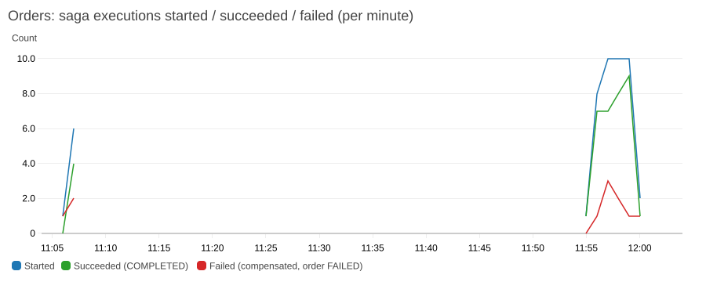

### Saga execution time p50 / p95 (ms) - flaky payments add retry backoff

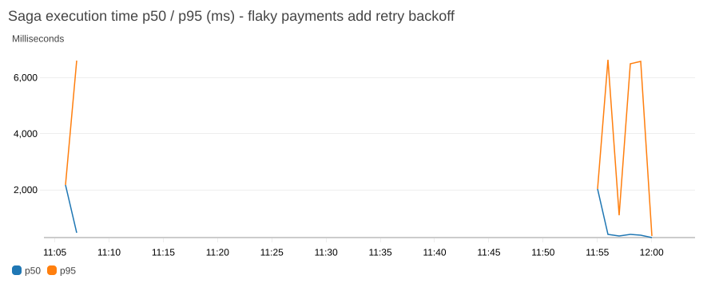

### API requests (order-saga-api)

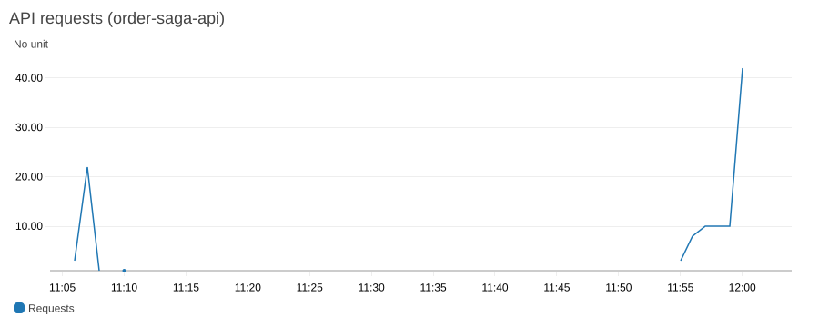

### API errors: 4xx (client) / 5xx (server)

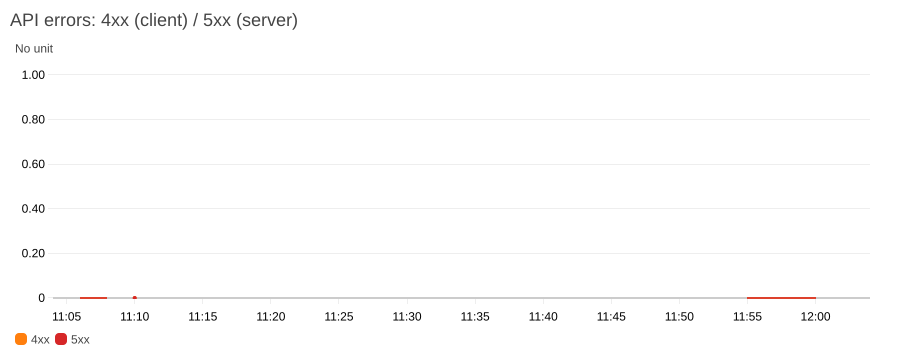

### API latency p50 / p95 (ms)

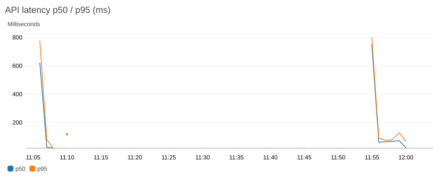

### Orders queue: backlog and age of oldest message

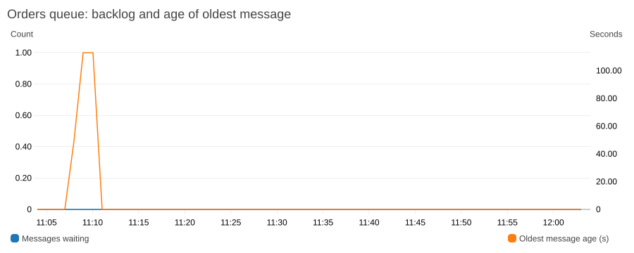

### Orders queue: messages sent / deleted (processed)

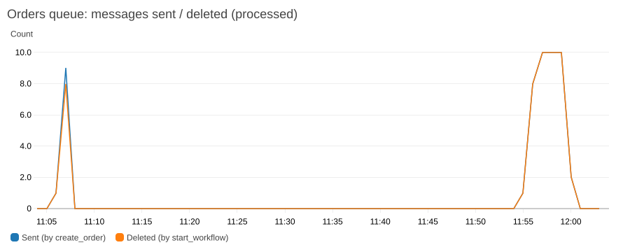

### DEAD-LETTER QUEUE: messages (should be 0)

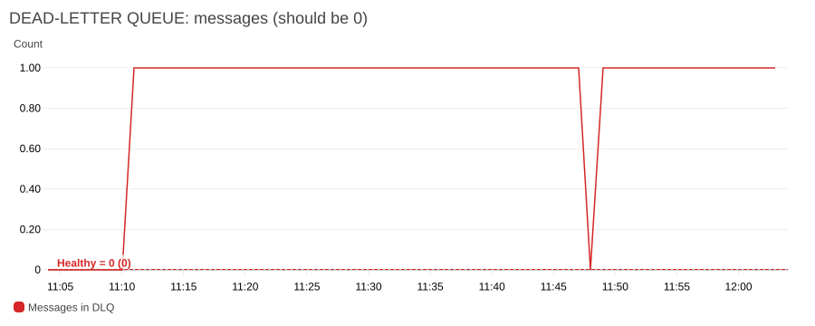

### Lambda invocations

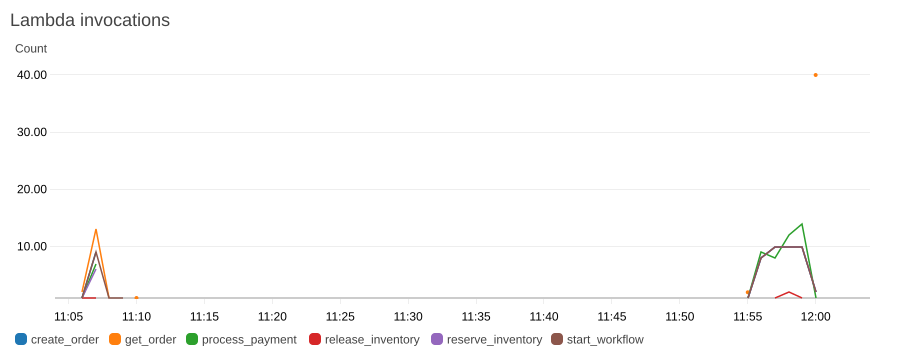

### Lambda errors (process_payment errors include simulated declines)

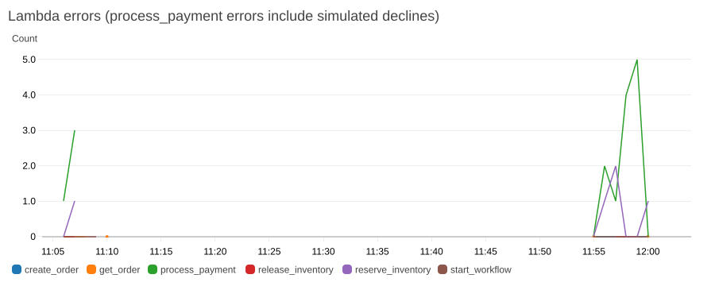

### Lambda duration p95 (ms)

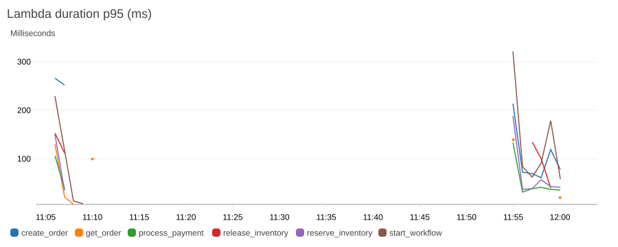

### Lambda throttles

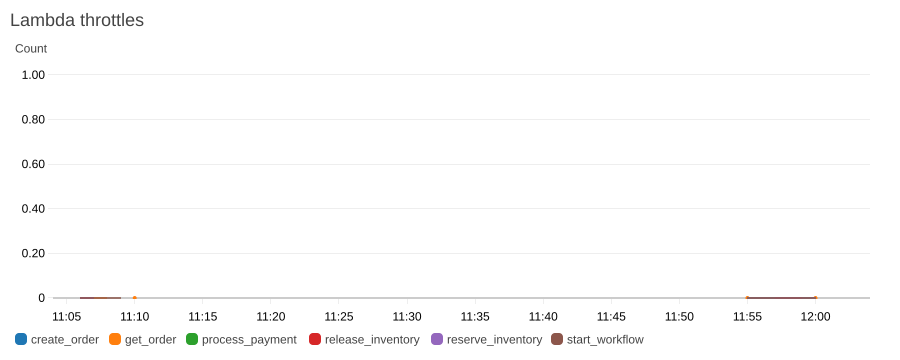

### DynamoDB consumed read capacity units

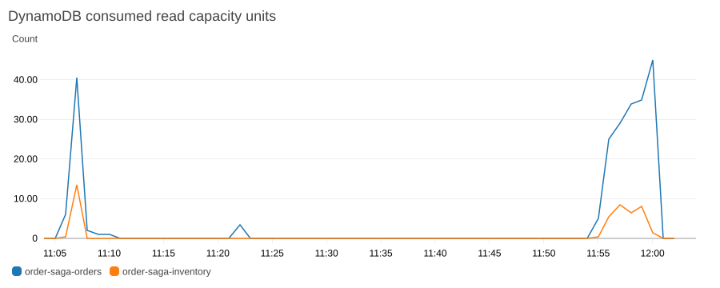

### DynamoDB consumed write capacity units

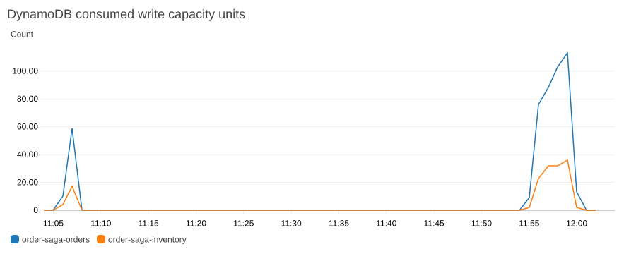

### DynamoDB throttled requests (orders, inventory)

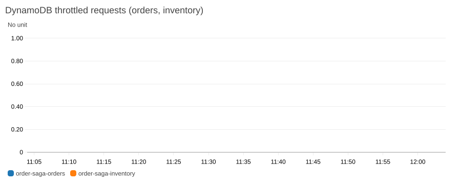

## X-Ray service map edges

```
order-saga-create-order (AWS::Lambda) -> order-saga-create-order (AWS::Lambda::Function)
order-saga-create-order (AWS::Lambda::Function) -> DynamoDB (AWS::DynamoDB)
order-saga-create-order (AWS::Lambda::Function) -> order-saga-idempotency (AWS::DynamoDB::Table)
order-saga-create-order (AWS::Lambda::Function) -> order-saga-inventory (AWS::DynamoDB::Table)
order-saga-create-order (AWS::Lambda::Function) -> order-saga-orders-queue (AWS::SQS::Queue)
order-saga-create-order (AWS::Lambda::Function) -> order-saga-start-workflow (AWS::Lambda)
order-saga-create-order (client) -> order-saga-create-order (AWS::Lambda)
order-saga-get-order (AWS::Lambda) -> order-saga-get-order (AWS::Lambda::Function)
order-saga-get-order (AWS::Lambda::Function) -> order-saga-orders (AWS::DynamoDB::Table)
order-saga-get-order (client) -> order-saga-get-order (AWS::Lambda)
order-saga-orders-queue (AWS::SQS::Queue) -> order-saga-start-workflow (AWS::Lambda)
order-saga-process-payment (AWS::Lambda) -> order-saga-process-payment (AWS::Lambda::Function)
order-saga-process-payment (AWS::Lambda::Function) -> order-saga-orders (AWS::DynamoDB::Table)
order-saga-release-inventory (AWS::Lambda) -> order-saga-release-inventory (AWS::Lambda::Function)
order-saga-release-inventory (AWS::Lambda::Function) -> DynamoDB (AWS::DynamoDB)
order-saga-release-inventory (AWS::Lambda::Function) -> order-saga-orders (AWS::DynamoDB::Table)
order-saga-reserve-inventory (AWS::Lambda) -> order-saga-reserve-inventory (AWS::Lambda::Function)
order-saga-reserve-inventory (AWS::Lambda::Function) -> DynamoDB (AWS::DynamoDB)
order-saga-reserve-inventory (AWS::Lambda::Function) -> order-saga-orders (AWS::DynamoDB::Table)
order-saga-start-workflow (AWS::Lambda) -> order-saga-start-workflow (AWS::Lambda::Function)
order-saga-start-workflow (AWS::Lambda::Function) -> StepFunctions (AWS::StepFunctions)
order-saga-start-workflow (AWS::Lambda::Function) -> order-saga-orders (AWS::DynamoDB::Table)
order-saga-start-workflow (client) -> order-saga-start-workflow (AWS::Lambda)
```

Notes on tracing:
- API Gateway **HTTP APIs** don't support X-Ray (only REST APIs do), so the map starts at the
  `create_order` Lambda and shows the caller as `client`.
- With botocore patched (`src/common/tracing.py`), the trace continues create_order -> SQS -> start_workflow
  -> StepFunctions -> reserve / payment / release Lambdas -> DynamoDB tables, as ONE trace ID.
- The state machine's own segment (AWS::StepFunctions::StateMachine) doesn't show up, even though tracing
  is enabled, its role has the 4 X-Ray permissions, and AssumeRole succeeds (checked in CloudTrail). Step
  Functions does pass the trace header on, because the Lambdas it invokes appear in the same trace. So its
  direct DynamoDB and SNS integrations are visible in the execution graph and in its logs, not on the map.

## Logs Insights: saved query 'order-saga/Trace one order' for `ORD-20261022-13c33683`

| Time | Log group | Source | Level | Event (message / state / error) |
|---|---|---|---|---|
| 2026-10-22 11:59:49.420 | `/aws/lambda/order-saga-create-order` | create_order | INFO | Order accepted |
| 2026-10-22 11:59:49.472 | `/aws/vendedlogs/states/order-saga-workflow` | ExecutionStarted |  |  |
| 2026-10-22 11:59:49.483 | `/aws/lambda/order-saga-start-workflow` | start_workflow | INFO | Saga execution started |
| 2026-10-22 11:59:49.490 | `/aws/vendedlogs/states/order-saga-workflow` | TaskScheduled |  |  |
| 2026-10-22 11:59:49.490 | `/aws/vendedlogs/states/order-saga-workflow` | TaskStateEntered |  | ReserveInventory |
| 2026-10-22 11:59:49.517 | `/aws/vendedlogs/states/order-saga-workflow` | TaskStarted |  |  |
| 2026-10-22 11:59:49.559 | `/aws/lambda/order-saga-reserve-inventory` | reserve_inventory | INFO | Inventory reserved |
| 2026-10-22 11:59:49.566 | `/aws/vendedlogs/states/order-saga-workflow` | TaskSucceeded |  |  |
| 2026-10-22 11:59:49.576 | `/aws/vendedlogs/states/order-saga-workflow` | TaskStateEntered |  | ProcessPayment |
| 2026-10-22 11:59:49.576 | `/aws/vendedlogs/states/order-saga-workflow` | TaskStateExited |  | ReserveInventory |
| 2026-10-22 11:59:49.576 | `/aws/vendedlogs/states/order-saga-workflow` | TaskScheduled |  |  |
| 2026-10-22 11:59:49.602 | `/aws/vendedlogs/states/order-saga-workflow` | TaskStarted |  |  |
| 2026-10-22 11:59:49.623 | `/aws/lambda/order-saga-process-payment` | process_payment | WARNING | Payment declined; saga will compensate |
| 2026-10-22 11:59:49.629 | `/aws/vendedlogs/states/order-saga-workflow` | TaskFailed |  | {"errorMessage":"Card declined by issuer (simulated)","errorType":"PaymentDeclined","requestId":"3b1a0186-5622-4d62-ab87-66c9f547381c","s... |
| 2026-10-22 11:59:49.640 | `/aws/vendedlogs/states/order-saga-workflow` | TaskStateExited |  | ProcessPayment |
| 2026-10-22 11:59:49.640 | `/aws/vendedlogs/states/order-saga-workflow` | TaskScheduled |  |  |
| 2026-10-22 11:59:49.640 | `/aws/vendedlogs/states/order-saga-workflow` | TaskStateEntered |  | ReleaseInventory |
| 2026-10-22 11:59:49.669 | `/aws/vendedlogs/states/order-saga-workflow` | TaskStarted |  |  |
| 2026-10-22 11:59:49.728 | `/aws/lambda/order-saga-release-inventory` | release_inventory | INFO | Inventory released |
| 2026-10-22 11:59:49.732 | `/aws/vendedlogs/states/order-saga-workflow` | TaskSucceeded |  |  |
| 2026-10-22 11:59:49.743 | `/aws/vendedlogs/states/order-saga-workflow` | TaskStateExited |  | ReleaseInventory |
| 2026-10-22 11:59:49.743 | `/aws/vendedlogs/states/order-saga-workflow` | PassStateExited |  | DescribeFailure |
| 2026-10-22 11:59:49.743 | `/aws/vendedlogs/states/order-saga-workflow` | PassStateEntered |  | DescribeFailure |
| 2026-10-22 11:59:49.743 | `/aws/vendedlogs/states/order-saga-workflow` | TaskStateEntered |  | MarkOrderFailed |
| 2026-10-22 11:59:49.743 | `/aws/vendedlogs/states/order-saga-workflow` | TaskScheduled |  |  |
| 2026-10-22 11:59:49.776 | `/aws/vendedlogs/states/order-saga-workflow` | TaskStarted |  |  |
| 2026-10-22 11:59:49.795 | `/aws/vendedlogs/states/order-saga-workflow` | TaskSucceeded |  |  |
| 2026-10-22 11:59:49.806 | `/aws/vendedlogs/states/order-saga-workflow` | TaskScheduled |  |  |
| 2026-10-22 11:59:49.806 | `/aws/vendedlogs/states/order-saga-workflow` | TaskStateExited |  | MarkOrderFailed |
| 2026-10-22 11:59:49.806 | `/aws/vendedlogs/states/order-saga-workflow` | TaskStateEntered |  | NotifyCustomerFailure |
| 2026-10-22 11:59:49.827 | `/aws/vendedlogs/states/order-saga-workflow` | TaskStarted |  |  |
| 2026-10-22 11:59:49.853 | `/aws/vendedlogs/states/order-saga-workflow` | TaskSucceeded |  |  |
| 2026-10-22 11:59:49.864 | `/aws/vendedlogs/states/order-saga-workflow` | TaskStateExited |  | NotifyCustomerFailure |
| 2026-10-22 11:59:49.864 | `/aws/vendedlogs/states/order-saga-workflow` | FailStateEntered |  | OrderFailed |
| 2026-10-22 11:59:49.876 | `/aws/vendedlogs/states/order-saga-workflow` | ExecutionFailed |  | PaymentDeclined: Card declined by issuer (simulated) |
| 2026-10-22 12:00:22.141 | `/aws/lambda/order-saga-get-order` | get_order | INFO | Order returned |
